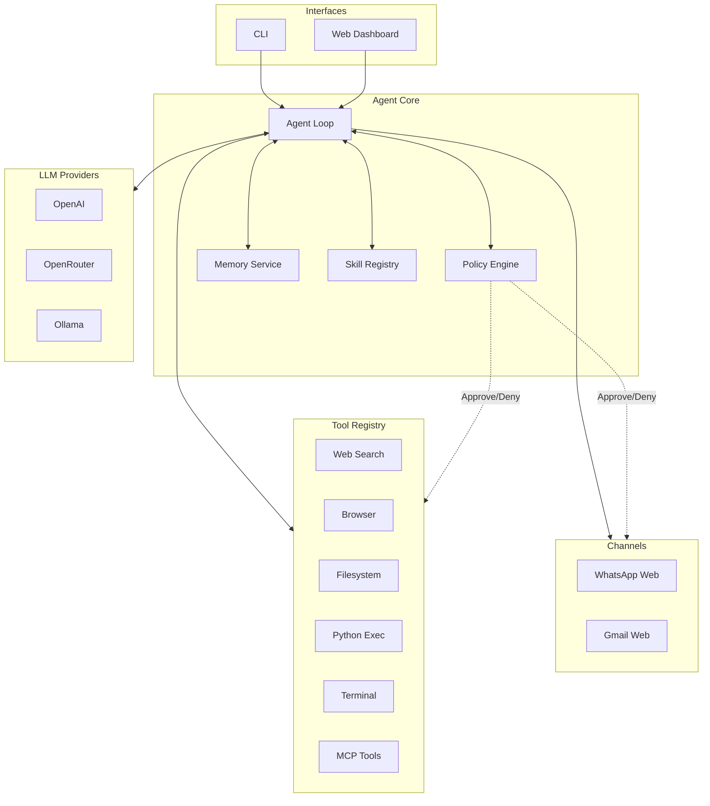

# Ribhus

**Open-source personal AI assistant agent with tool calling, MCP support, swappable LLM providers, and human-in-the-loop approvals.**

<p align="center">
  
</p>

Ribhus is an AI agent that doesn't just chat — it acts. Search the web, browse pages, run code, manage files, and send messages through WhatsApp or Gmail — all with approval gates before anything risky happens. Run it locally, pick your model provider, and stay in control.

## Why Ribhus?

Most AI assistants stop at conversation. You still have to copy the answer, open another app, paste, click, and send.

Ribhus closes that gap:

- **Tool calling**: The agent can search, browse, extract data, run Python, and use shell commands.
- **Model Context Protocol (MCP)**: Plug in external tools via stdio MCP servers — same approval flow as built-in tools.
- **Swappable LLM providers**: OpenAI, OpenRouter, Ollama, or any OpenAI-compatible endpoint.
- **Human-in-the-loop**: Risky actions pause for Approve / Edit / Cancel before executing.
- **Channels**: WhatsApp Web and Gmail Web browser automation with mandatory send approval.
- **Skills**: Installable workflow packages for research, travel planning, and more.
- **Memory**: Persistent context across sessions — preferences, past tasks, and conversation history.
- **Local-first**: Runs on your machine. Your data stays with you.

## Features

| Category | Capabilities |
|----------|-------------|
| **Interfaces** | CLI, local web dashboard |
| **Tools** | Web search, page extraction, browser automation, file read/write/edit, Python execution, terminal, HTTP requests, location, maps |
| **Channels** | WhatsApp Web, Gmail Web (browser automation with approval gates) |
| **MCP** | Stdio MCP servers exposed as `server__tool`, same policy enforcement |
| **Models** | OpenAI, OpenRouter, Ollama, any OpenAI-compatible API |
| **Approvals** | Risk levels (low/medium/high/critical), configurable auto-approve threshold, audit log |
| **Memory** | SQLite-backed: short-term context, episodic history, user preferences |
| **Skills** | Installable skill packages: company research, travel, football |

## Architecture



## Quick Start

**Requirements:** Python 3.11+, [uv](https://docs.astral.sh/uv/)

```bash
git clone https://github.com/Shlok221B/Ribhus.git
cd Ribhus

cp .env.example .env
# Edit .env: set RIBHUS_API_KEY (OpenAI, OpenRouter, or "ollama" for local)

uv sync --extra dev
uv run playwright install chromium

uv run ribhus
```

**One-shot examples:**

```bash
uv run ribhus "What is the weather in Tokyo?"
uv run ribhus "Research this company: Stripe"
uv run ribhus "Find hotels in Lisbon under €150 for this weekend"
```

**Interactive mode:**

```bash
uv run ribhus
# Type prompts, see tool calls, approve actions, get results
```

**Dashboard:**

```bash
uv sync --extra dashboard --extra dev
cd web && npm install && npm run build && cd ..
uv run ribhus dashboard
# Opens http://127.0.0.1:8742
```

## Configuration

Copy `.env.example` to `.env` and configure:

### LLM Provider

| Provider | `RIBHUS_BASE_URL` | `RIBHUS_API_KEY` | `RIBHUS_MODEL` |
|----------|-------------------|------------------|----------------|
| OpenAI | `https://api.openai.com/v1` | `sk-...` | `gpt-4o-mini` |
| OpenRouter | `https://openrouter.ai/api/v1` | `sk-or-...` | `google/gemma-3-27b-it` |
| Ollama | `http://localhost:11434/v1` | `ollama` | `gemma4:26b` |

### Approval Thresholds

```bash
RIBHUS_AUTO_APPROVE=false      # Require approval for risky tools
RIBHUS_APPROVE_AT=high         # Approval threshold: low|medium|high|critical
```

### Channels

```bash
# WhatsApp Web (browser automation — not official API)
RIBHUS_WHATSAPP_ENABLED=true
RIBHUS_WHATSAPP_HEADED=true    # Show browser for QR login

# Gmail Web (browser automation — not Gmail API)
RIBHUS_EMAIL_ENABLED=true
RIBHUS_EMAIL_HEADED=true       # Show browser for Google sign-in
```

### Memory

```bash
RIBHUS_MEMORY_ENABLED=true     # Persistent memory across sessions
```

See [docs/setup.md](docs/setup.md) for complete configuration reference.

## Human-in-the-Loop Safety Model

Ribhus classifies every tool by risk level:

| Risk Level | Examples | Default Behavior |
|------------|----------|------------------|
| **Low** | Web search, read file, location lookup | Auto-approved |
| **Medium** | HTTP requests, browser navigation | Configurable |
| **High** | Write file, Python execution, terminal | Requires approval |
| **Critical** | (Reserved for payments, deletions) | Always requires approval |

**Channel sends always require approval** — `whatsapp_send` and `email_send` pause for Approve / Edit / Cancel regardless of `RIBHUS_AUTO_APPROVE` setting.

The approval flow:

1. Agent requests a tool call
2. PolicyEngine checks risk level vs configured threshold
3. If approval required: CLI/dashboard shows the action details
4. User chooses: **Approve** (run it), **Edit** (modify arguments), or **Cancel** (deny)
5. Decision is logged to audit trail

```bash
# View audit log
cat .ribhus/audit.jsonl
```

## MCP (Model Context Protocol)

Connect external MCP servers as tools:

```bash
uv run ribhus mcp init          # Create .ribhus/mcp.json
uv run ribhus mcp list          # Show configured servers
uv run ribhus mcp test demo     # Test a server
```

MCP tools appear as `server__tool` (e.g., `demo__add`). They follow the same approval policy as built-in tools.

Example `mcp.json`:

```json
{
  "servers": {
    "demo": {
      "command": "python",
      "args": ["examples/mcp_demo_server.py"],
      "enabled": true
    }
  }
}
```

## Skills

Skills are installable workflow packages with prompts, constraints, and examples:

```bash
uv run ribhus skill list
uv run ribhus skill install company-research
uv run ribhus skill install travel
uv run ribhus skill install football
uv run ribhus skill create my-skill
uv run ribhus skill validate ./skills/my-skill
uv run ribhus skill remove my-skill
```

Installed skills live in `.ribhus/skills/`. See [docs/skills.md](docs/skills.md) for the skill format.

## Memory

Ribhus remembers across sessions:

```bash
uv run ribhus memory list
uv run ribhus memory search "preferences"
uv run ribhus memory add "Prefer concise answers" --key style
uv run ribhus memory forget style
uv run ribhus memory export --out memories.json
uv run ribhus memory disable
```

Memory is stored in `.ribhus/memory.sqlite`. Disable with `RIBHUS_MEMORY_ENABLED=false`.

## Channels

### WhatsApp Web

Browser automation for WhatsApp Web (not the official API). Subject to WhatsApp ToS.

```bash
uv run ribhus whatsapp status
uv run ribhus whatsapp status --check-login
uv run ribhus whatsapp listen          # Monitor Note to Self for approvals
uv run ribhus whatsapp kill

uv run ribhus "Find my chat with Alex, draft a reply, and ask before sending"
```

First login: set `RIBHUS_WHATSAPP_HEADED=true`, then scan QR code in the browser.

### Gmail Web

Browser automation for Gmail (not the Gmail API). Subject to Google ToS.

```bash
uv run ribhus email status --check-login
uv run ribhus email kill

uv run ribhus "Check my inbox and draft a reply to the latest email"
```

**Both channels require explicit approval before sending.** The agent cannot bypass this.

## Development

```bash
uv run pytest                   # Run tests
uv run ribhus eval              # Run evaluation suite
uv run ribhus eval --category safety --json
```

The eval suite uses mocked HTTP and channel fixtures — no API key or login required.

## Roadmap

- [ ] Cancel/stop running tasks from dashboard
- [ ] Fingerprinted approvals (Allow once / Always allow / Deny)
- [ ] Untrusted content fencing (prompt injection resistance)
- [ ] More channels: Telegram, Discord, HTTP API
- [ ] Background task scheduling
- [ ] Skill registry and verification
- [ ] Multi-agent orchestration

See [docs/blueprint-gap-tasks.md](docs/blueprint-gap-tasks.md) for detailed task tracking.

## Contributing

Contributions are welcome. See [CONTRIBUTING.md](CONTRIBUTING.md) for guidelines.

## Security

For security issues, see [SECURITY.md](SECURITY.md).

## Makers

Built by:

- **[Shlok Sawant](https://shloksawant.com)** — [GitHub](https://github.com/Shlok221B)
- **Shubham Gupta** — [GitHub](https://github.com/gshubham533)

## License

[MIT](LICENSE) © 2026 Shlok Sawant and Shubham Gupta
